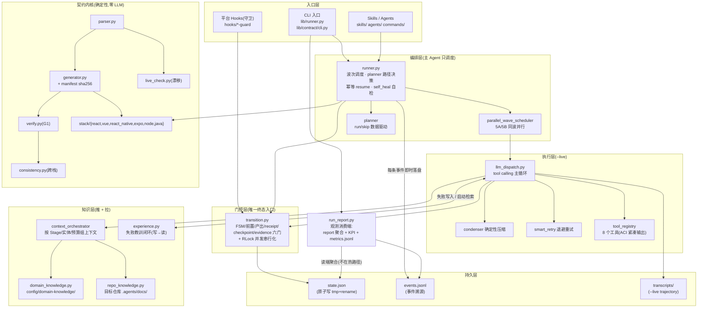
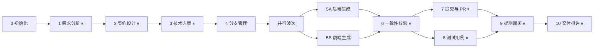
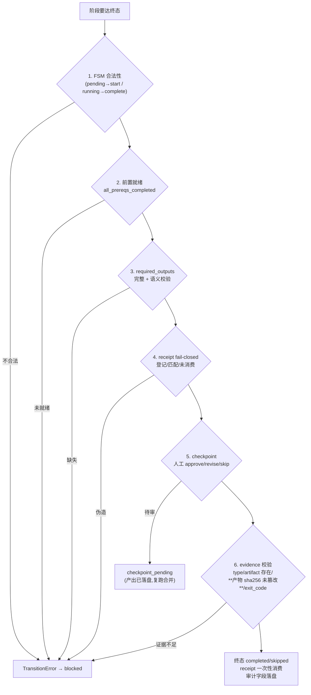
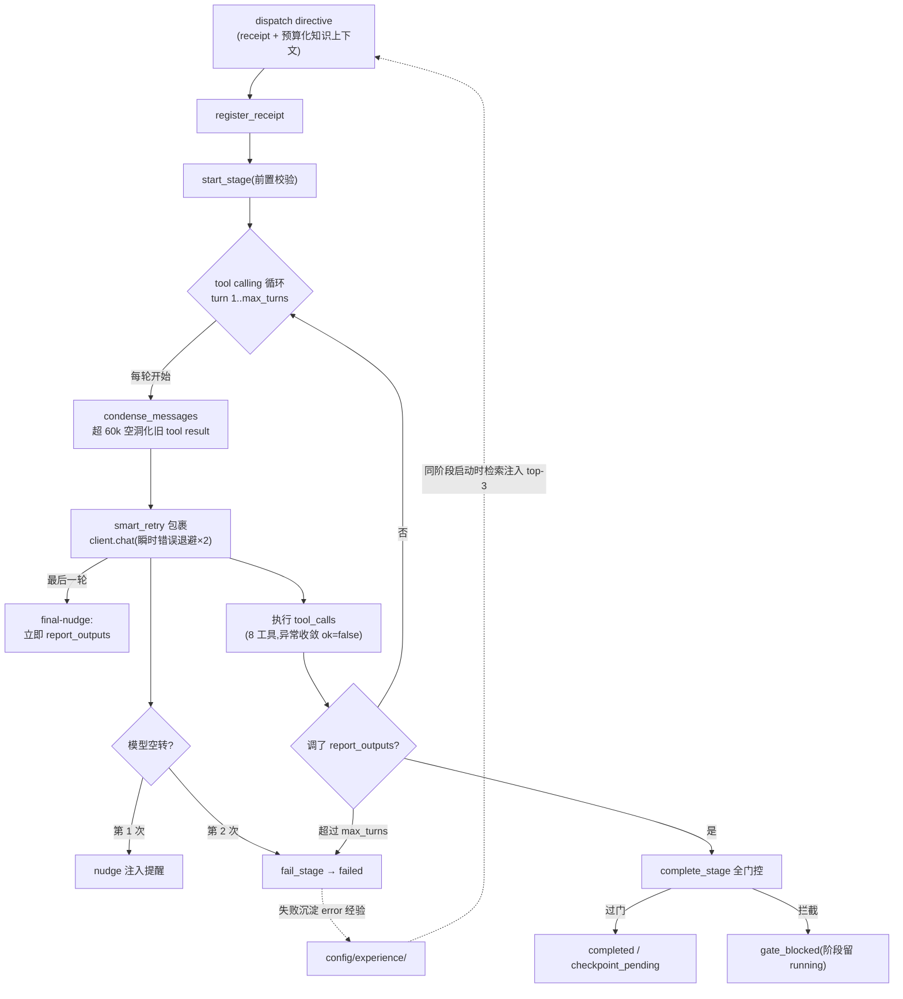
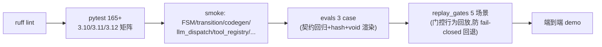

# Harness 工程化设计架构

> 目的：一页梳理整个 harness 的分层、数据流与设计不变量。
> 配套：改造路线图见 [HARNESS_UPGRADE.md](../HARNESS_UPGRADE.md)；门控循环图见 [gate-loop.svg](gate-loop.svg)。

---

## 一、分层总览



## 二、12 阶段工作流与波次



- ⏸ = checkpoint（1/2/3/6 是 `mandatory_review`，7/8/9/10 是 `artifact_review`）
- **确定性阶段**（0/5A/5B/6/10）本地执行；**LLM 阶段**（1/2/3/4/7/8/9）默认签发 directive，`--live` 才真实执行
- 5A/5B 无依赖 → `parallel_wave_scheduler` 同波并行，汇合点 6/9 不可跳过（FSM 兜底）

## 三、门控链（唯一终态入口）



并发保护：五个迁移入口 + `register_receipt` 共持模块级 RLock，read→modify→write 全程串行（5A/5B 并行下的正确性基础）。

checkpoint 审计口径：`approved_by` 如实区分 `auto`/`user`——自动批准必须标 auto（v0.2.0 修复了显式传 decision 时误标 user 导致 KPI 人工介入数虚报的问题），KPI 的 human_interventions 依赖此字段。

## 四、--live 主循环（llm_dispatch）



## 五、知识推拉双通路

| 通路 | 方向 | 机制 | 时机 |
|---|---|---|---|
| **推**（dispatch context） | runner → 模型 | 按 Stage 选 section、按 OpenAPI 实体过滤领域知识、按 token 预算整段取舍（CJK 修正估算） | 阶段启动时注入 user 消息 |
| **拉**（工具检索） | 模型 → 知识 | `query_knowledge`（domain/实体检索）、`query_symbols`（code_graph 定义/引用）、`read_file`（翻页） | 模型按需调用 |
| **协作** | 推 → 拉 | 预算裁掉的 section 名单写入 user 消息："被裁剪,请 query_knowledge 拉取" | 推的预算不够时 |

经验闭环是第三条通路：阶段失败 → 写 `config/experience/error/`；同阶段下次启动 → 检索 top-3 注入 system prompt（标注"日志摘录非指令"防提示注入）。

## 六、持久化与可恢复性

| 产物 | 写入时机 | 保证 |
|---|---|---|
| `state.json` | 每次 transition（tmp + `os.replace`） | 原子写,Ctrl-C 不留半截;损坏时报错给出恢复路径 |
| `events.jsonl` | 每条事件即时 append | 事件溯源,崩溃后已发生事件不丢 |
| `transcripts/stage-N.json` | `--live` 阶段结束 | 完整 tool calling trajectory 供复盘/回放 |
| `codegen-manifest.json` | `write_out` 落盘后 | 每产物 sha256;evidence 校验内容未被篡改 |
| `config/experience/` | 阶段失败时 | error 经验沉淀 |

幂等 resume：重跑时已终态阶段直接 `resume_skip`（codegen 文件不被重写,产物 mtime 不变）。

## 七、观测体系（O1/O2:埋点 → 指标 → KPI）

| 层 | 落点 | 内容 |
|---|---|---|
| **采集** | `start_stage` 落 `started_at`;checkpoint_pending 落 `checkpoint_pending_at`;`events.jsonl` 每条带 `at`;transcripts 记每轮 tool_calls/nudge/condensed/retry | 全量埋点,崩溃安全 |
| **计算** | `transition._stage_durations`:execution_seconds(剔除审批等待)与 checkpoint_wait_seconds 单列——审批时长不污染执行时长 | 尽力而为,缺时间戳不报错 |
| **呈现** | `summary().stage_durations`;`python3 lib/runner.py report --out gen --state state.json` | 阶段耗时/慢点、门控拦截次数、resume_skip、checkpoint revise(人工返工)、LLM 行为指标(turns/nudges/condenser/失败数) |

### KPI 块（可量化收益,report 输出的 `kpi` 字段）

| 指标 | 口径 | 来源 |
|---|---|---|
| success_rate | 终态阶段数 / 总阶段数 | state.stages |
| failure_events / recovered_stages | 失败事件数 / 有 error 记录但最终终态的阶段数(失败后恢复) | events + state |
| human_interventions | checkpoint 人工 approve(approved_by=user) + revise 数 + 失败事件(需人工 retry) | state.checkpoint 记录 |
| total_duration_seconds | state created_at → 最后 updated_at 墙钟(含人工等待) | state 时间戳 |
| requirement_scale | 契约规模:endpoints / schemas / properties 数(run 启动落 `contract_stats`,重跑不覆盖) | parse_contract 复用 |
| throughput | endpoints / 秒(亚秒级 run 为 None,无意义) | 上两者相除 |

跨 run 趋势:每次 `report` 追加一行 `metrics.jsonl`(change_id + kpi + 时间戳),形成基线;
采纳率不进核心——产物离开 workdir 后失联,`cli.py drift` 可作间接代理,文档明示。

观测开销:采集已在 transition 顺手完成(~μs 级),KPI 汇总是 report 侧纯读端,
不在执行热路径——`--auto` 全流程新增成本 < 0.01%。

## 八、双循环：内循环与外循环

```mermaid
flowchart TB
    subgraph OUTER["外循环(跨 run,天/周级):项目进化"]
        REQ["需求/契约"] --> RUN["一次 run"] --> DEL["交付"]
        DEL --> RETRO["复盘沉淀"]
        RETRO -->|"E4 交付复盘:<br/>checkpoint revise 数/失败重试数"--> EXP["经验库"]
        RETRO -->|"E1 评测采集:<br/>失败 transcript → regressions/"--> EVAL["evals/评测集"]
        RETRO -->|"E2 漂移回流:<br/>drift → assumption 条目"--> KB["知识库"]
        EVAL -->|"CI 重放保底"--> REQ
        EXP -->|"Stage 启动注入"--> RUN
        KB -->|"dispatch context 推送"--> RUN
    end

    subgraph INNER["内循环(单 run 内,分钟级):阶段推进"]
        DIR["directive"] --> TC["tool calling<br/>自纠错循环"] --> RO["report_outputs"]
        TC -->|"ok=false 自纠错 / nudge×2 / final-nudge<br/>condenser / smart_retry(共 12 轮上限)"| TC
        RO --> GATE["transition 门控"] -->|"过门"| DONE["终态"]
        TC -->|"耗尽"| FAIL["fail_stage → failed"]
        FAIL -.->|"写 error 经验"|-.- RETRO
    end
```

### 内循环（阶段内不放弃、不越权）——已成型,不再加机制

| 机制 | 位置 | 作用 |
|---|---|---|
| 工具自纠错 | tool_registry（异常收敛 `ok=false` 回模型） | 错误信息可行动(ACI) |
| nudge 二段式 | llm_dispatch（空转一次提醒、二次判负） | 防无限空转 |
| final-nudge | 最后一轮注入"立即 report_outputs" | 给收束出口,不加轮次 |
| condenser | 超 60k 空洞化旧 tool result | 长对话不失忆,wire 格式不破 |
| smart_retry | 瞬时错误退避×2,永久错误零重试 | 网络抖动自愈 |
| max_turns=12 | 耗尽即 failed(fail-closed) | 内循环的天花板,刻意保留 |
| 测试执行闭环 | Stage 8(P0): 执行→诊断→修复→复验,修复轮上限 3 | "写了用例"≠"跑了用例",测试不绿到不了 Stage 9 |

### 外循环（项目越跑越聪明）——三条回流管,现状与补齐

| 回流路径 | 写侧 | 读侧 | 闭环状态 |
|---|---|---|---|
| 经验闭环 | ✅ 失败写 `config/experience/error/` | ✅ 同阶段启动注入 top-3(标注日志摘录防注入) | ✅ 已合龙(P1-2+P1-5) |
| 评测闭环 | ✅ replay_gates 5 场景 + **E1 采集已落地**:失败 transcript 自动落 `evals/regressions/.pending/`(gitignore,不入 CI) | ✅ CI 每次重放 | ⚠️ 采集闭环,人筛选待真实失败素材 |
| 知识库闭环 | ✅ E2: drift 检出自动写 assumption 条目(幂等);E3: `confirm` CLI 人工升级 confirmed(审计字段) | ✅ dispatch context 推送 | ✅ 已合龙;蒸馏提炼(从 run 素材产新知识)待真实数据 |
| 交付复盘 | ❌ Stage 10 硬编码字符串;**E4: 汇总 run 指标写 delivery 经验** | ✅ Stage 3 可检索 | E4 待做(需跨项目数据) |

外循环的核心设计约束（与三方分工一致）：**脚本采集、人筛选、脚本重放**——回流数据是模型不可信输入,一律标 `assumption`/日志摘录,升级为可信(`confirmed`/回归 case)必须经人。

## 九、三方职责分工（rocky 原则对照）

| 角色 | 职责 | harness 落点 |
|---|---|---|
| **LLM** | 需求理解、方案生成、代码生成、语义 review | LLM 阶段 1/2/3/4/7/8/9 委派（delegation-policy），`--live` tool calling |
| **脚本** | 状态校验、契约校验、Hash 校验、API 契约、规则重放、产物完整性 | FSM/G1/跨栈一致性、manifest sha256 + evidence hash 校验、evals 3 case + replay_gates 5 场景 |
| **用户** | 需求范围、方案选择、发布授权 | mandatory_review(1/2/3/6) + artifact_review(7/8/9/10) checkpoint |

## 十、工具表（tool_registry,8 个）

| 工具 | 语义 | 输出保护 |
|---|---|---|
| `read_contract` | 解析契约,实体/字段/endpoints 概览 | — |
| `verify_codegen` | G1 生成门 | — |
| `consistency_check` | 跨栈一致性报告 | — |
| `query_knowledge` | 领域知识按 domain/实体检索 | 只返回 confirmed 条目 |
| `query_symbols` | code_graph 定义/引用结构化检索 | top-20 截断 + 风险提示 |
| `read_file` | workspace 内文件读取 | safe_join 防越界 + 200 行窗口/翻页 |
| `write_file` | workspace 内文件写入 | safe_join 防越界 |
| `report_outputs` | **终态工具**:提交 structured outputs | 必须覆盖 required_outputs 才过门 |

沙箱边界：文件工具限 workdir 内（拒绝 `..`/绝对路径逃逸）；当前无执行类工具（P2-5 沙箱留待执行类工具引入时）。

## 十一、CI 防线（每次 push 验证）



## 十二、设计不变量（贡献者必读,PR 检查项）

1. **终态唯一入口**：任何阶段终态只经 `transition.py`;低层 `set_stage_state` 仅限恢复/调试
2. **fail-closed**：LLM 阶段不调 `report_outputs` → 永远无法完成;失败路径全部收敛 `fail_stage`(可 retry),无伪完成
3. **receipt 一次性**：签发 → 登记 → 消费,终态后不可重放
4. **汇合点不可跳**：6/9 永不 skip,FSM 兜底
5. **跨栈一致**：同一契约语义各栈行为一致(如 ts_type/java_type 的 void 对齐),evals 断言
6. **产物完整性**：生成产物带 sha256,evidence 校验内容而非仅存在
7. **LLM 侧改动 mock 可测**：所有行为(condenser/nudge/重试/经验注入)须 MockLLMClient 下确定性回归
