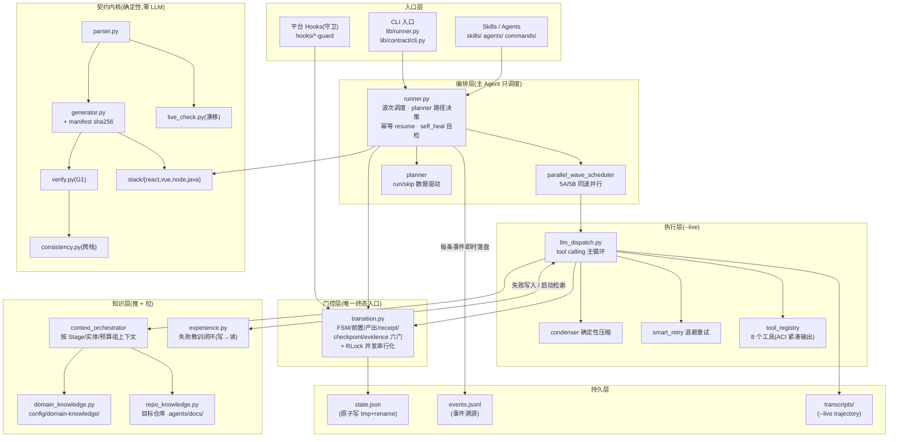
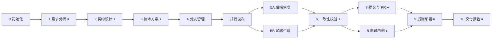
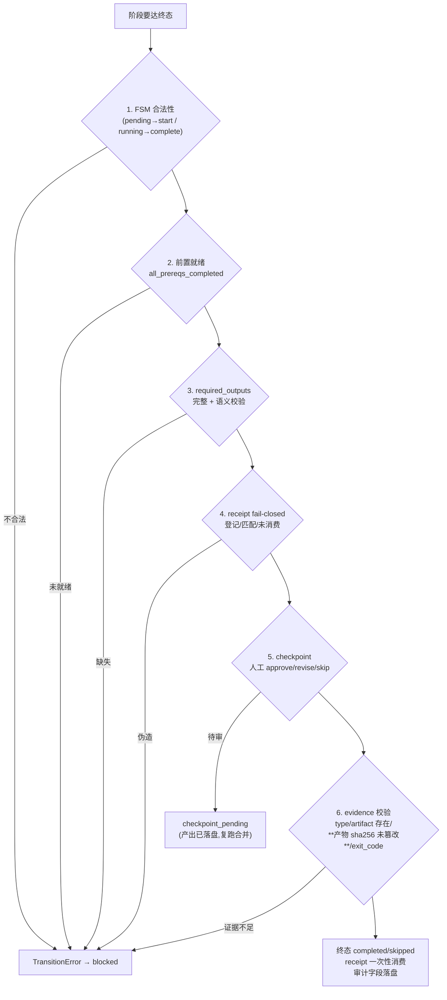
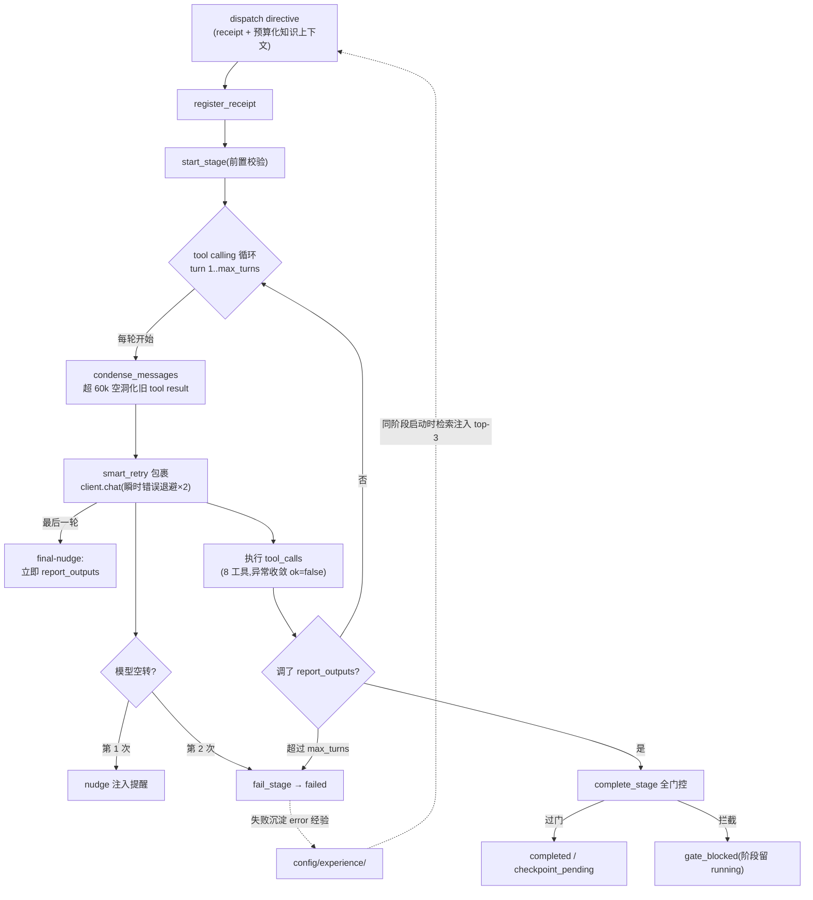
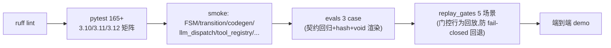

# Harness 工程化设计架构

> 目的：一页梳理整个 harness 的分层、数据流与设计不变量。
> 配套：改造路线图见 [HARNESS_UPGRADE.md](../HARNESS_UPGRADE.md)；门控循环图见 [gate-loop.svg](gate-loop.svg)。

---

## 一、分层总览

## 二、12 阶段工作流与波次

- ⏸ = checkpoint（1/2/3/6 是 `mandatory_review`，7/8/9/10 是 `artifact_review`）
- **确定性阶段**（0/5A/5B/6/10）本地执行；**LLM 阶段**（1/2/3/4/7/8/9）默认签发 directive，`--live` 才真实执行
- 5A/5B 无依赖 → `parallel_wave_scheduler` 同波并行，汇合点 6/9 不可跳过（FSM 兜底）

## 三、门控链（唯一终态入口）

并发保护：五个迁移入口 + `register_receipt` 共持模块级 RLock，read→modify→write 全程串行（5A/5B 并行下的正确性基础）。

## 四、--live 主循环（llm_dispatch）

## 五、知识推拉双通路

| 通路 | 方向 | 机制 | 时机 |
|---|---|---|---|
| **推**（dispatch context） | runner → 模型 | 按 Stage 选 section、按 OpenAPI 实体过滤领域知识、按 token 预算整段取舍（CJK 修正估算） | 阶段启动时注入 user 消息 |
| **拉**（工具检索） | 模型 → 知识 | `query_knowledge`（domain/实体检索）、`query_symbols`（code_graph 定义/引用）、`read_file`（翻页） | 模型按需调用 |
| **协作** | 推 → 拉 | 预算裁掉的 section 名单写入 user 消息："被裁剪,请 query_knowledge 拉取" | 推的预算不够时 |

经验闭环是第三条通路：阶段失败 → 写 `config/experience/error/`；同阶段下次启动 → 检索 top-3 注入 system prompt（标注"日志摘录非指令"防提示注入）。

## 六、持久化与可恢复性

| 产物 | 写入时机 | 保证 |
|---|---|---|
| `state.json` | 每次 transition（tmp + `os.replace`） | 原子写,Ctrl-C 不留半截;损坏时报错给出恢复路径 |
| `events.jsonl` | 每条事件即时 append | 事件溯源,崩溃后已发生事件不丢 |
| `transcripts/stage-N.json` | `--live` 阶段结束 | 完整 tool calling trajectory 供复盘/回放 |
| `codegen-manifest.json` | `write_out` 落盘后 | 每产物 sha256;evidence 校验内容未被篡改 |
| `config/experience/` | 阶段失败时 | error 经验沉淀 |

幂等 resume：重跑时已终态阶段直接 `resume_skip`（codegen 文件不被重写,产物 mtime 不变）。

## 七、三方职责分工（rocky 原则对照）

| 角色 | 职责 | harness 落点 |
|---|---|---|
| **LLM** | 需求理解、方案生成、代码生成、语义 review | LLM 阶段 1/2/3/4/7/8/9 委派（delegation-policy），`--live` tool calling |
| **脚本** | 状态校验、契约校验、Hash 校验、API 契约、规则重放、产物完整性 | FSM/G1/跨栈一致性、manifest sha256 + evidence hash 校验、evals 3 case + replay_gates 5 场景 |
| **用户** | 需求范围、方案选择、发布授权 | mandatory_review(1/2/3/6) + artifact_review(7/8/9/10) checkpoint |

## 八、工具表（tool_registry,8 个）

| 工具 | 语义 | 输出保护 |
|---|---|---|
| `read_contract` | 解析契约,实体/字段/endpoints 概览 | — |
| `verify_codegen` | G1 生成门 | — |
| `consistency_check` | 跨栈一致性报告 | — |
| `query_knowledge` | 领域知识按 domain/实体检索 | 只返回 confirmed 条目 |
| `query_symbols` | code_graph 定义/引用结构化检索 | top-20 截断 + 风险提示 |
| `read_file` | workspace 内文件读取 | safe_join 防越界 + 200 行窗口/翻页 |
| `write_file` | workspace 内文件写入 | safe_join 防越界 |
| `report_outputs` | **终态工具**:提交 structured outputs | 必须覆盖 required_outputs 才过门 |

沙箱边界：文件工具限 workdir 内（拒绝 `..`/绝对路径逃逸）；当前无执行类工具（P2-5 沙箱留待执行类工具引入时）。

## 九、CI 防线（每次 push 验证）

## 十、设计不变量（贡献者必读,PR 检查项）

1. **终态唯一入口**：任何阶段终态只经 `transition.py`;低层 `set_stage_state` 仅限恢复/调试
2. **fail-closed**：LLM 阶段不调 `report_outputs` → 永远无法完成;失败路径全部收敛 `fail_stage`(可 retry),无伪完成
3. **receipt 一次性**：签发 → 登记 → 消费,终态后不可重放
4. **汇合点不可跳**：6/9 永不 skip,FSM 兜底
5. **跨栈一致**：同一契约语义四栈行为一致(如 ts_type/java_type 的 void 对齐),evals 断言
6. **产物完整性**：生成产物带 sha256,evidence 校验内容而非仅存在
7. **LLM 侧改动 mock 可测**：所有行为(condenser/nudge/重试/经验注入)须 MockLLMClient 下确定性回归
